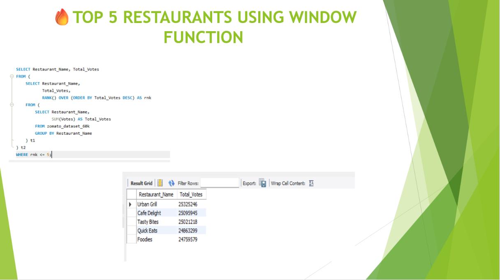
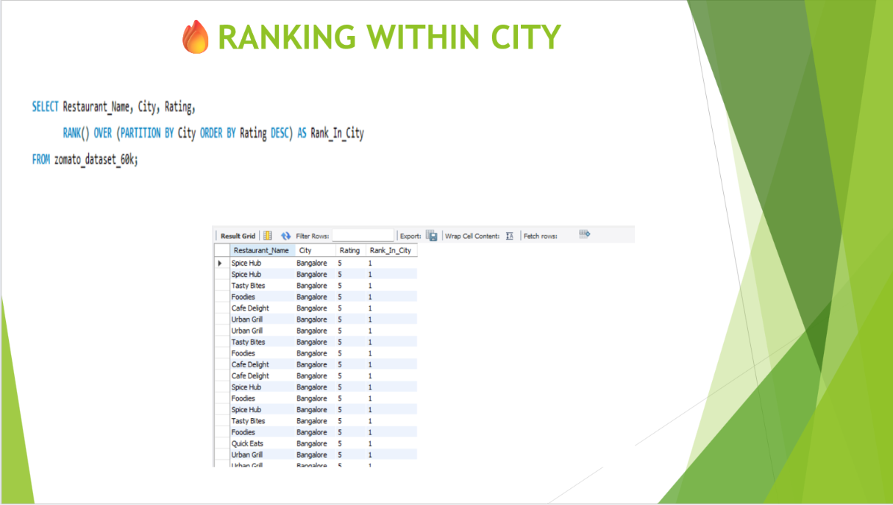

# Zomato Sales and Performance Analysis | MySQL

A SQL project that analyzes 60,000 Zomato restaurant records to find top restaurants, popular cuisines, and city-wise performance using aggregation, subqueries, and window functions.

## Dataset
- Table: `zomato_dataset_60k` (60,000 rows, 9 columns)
- Columns: Restaurant_ID, Restaurant_Name, City, Cuisine, Average_Cost, Rating, Votes, Online_Order, Table_Booking

## Metric Definitions (assumptions)
- **Revenue** = Average_Cost x Votes (votes are used as a proxy for orders)
- **Popularity / Activity** = total Votes
- **Profit** = 30% of Average_Cost (a fixed assumption, because the dataset has no profit column)
- **Repeat vs One-time** = a restaurant name appearing more than once in the data

## SQL Concepts Used
- Aggregation: SUM, COUNT
- GROUP BY, ORDER BY, LIMIT
- Subqueries (nested queries)
- Window functions: RANK(), LAG(), SUM() OVER()
- PARTITION BY for ranking within a city
- CASE WHEN for classification

## Analysis Performed
1. Revenue calculation (Average_Cost x Votes)
2. Total orders by city
3. Top 5 restaurants by total votes (RANK with a subquery)
4. Cuisine ranking by popularity
5. Percentage contribution of each cuisine
6. Revenue per restaurant
7. Repeat vs one-time restaurants (CASE WHEN)
8. Profit and profit percentage per restaurant
9. Highest performing city
10. Previous vs current votes comparison using LAG
11. Restaurant ranking within each city by rating

## Sample Queries

**Top 5 restaurants using a window function**
```sql
SELECT Restaurant_Name, Total_Votes
FROM (
    SELECT Restaurant_Name, Total_Votes,
           RANK() OVER (ORDER BY Total_Votes DESC) AS rnk
    FROM (
        SELECT Restaurant_Name, SUM(Votes) AS Total_Votes
        FROM zomato_dataset_60k
        GROUP BY Restaurant_Name
    ) t1
) t2
WHERE rnk <= 5;
```

**Ranking within each city**
```sql
SELECT Restaurant_Name, City, Rating,
       RANK() OVER (PARTITION BY City ORDER BY Rating DESC) AS Rank_In_City
FROM zomato_dataset_60k;
```

## Key Insights
- Add 3 real findings from your result tables here, for example the top cuisine by votes, the top city, and the top restaurant.

## Screenshots



## Project Presentation
See `Presentation_FINAL_PPT.pptx` for the full walkthrough.

## Author
**Abhijay Kanojiya**
LinkedIn: [linkedin.com/in/abhijay-kanojiyaa](https://linkedin.com/in/abhijay-kanojiyaa)
Email: abhijaykanojiyaa@gmail.com
